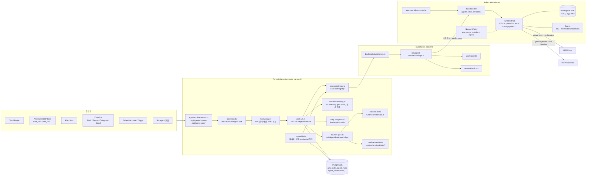
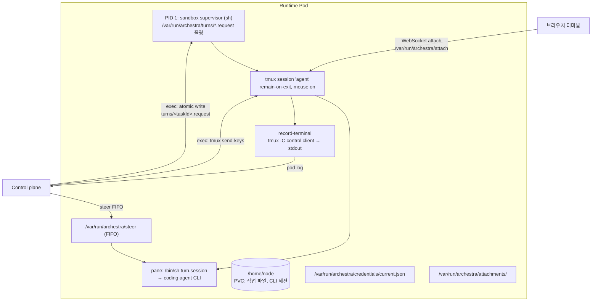
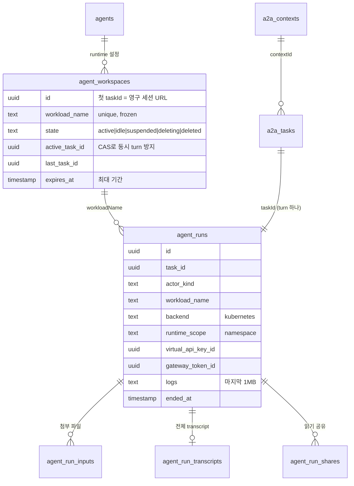
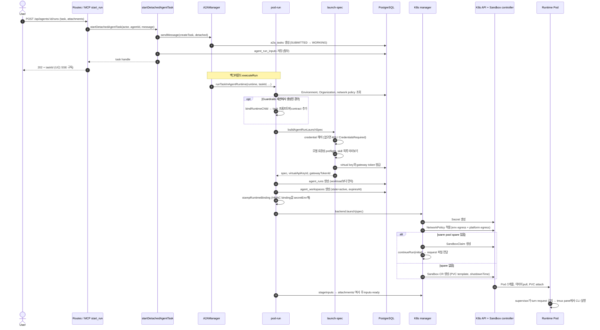
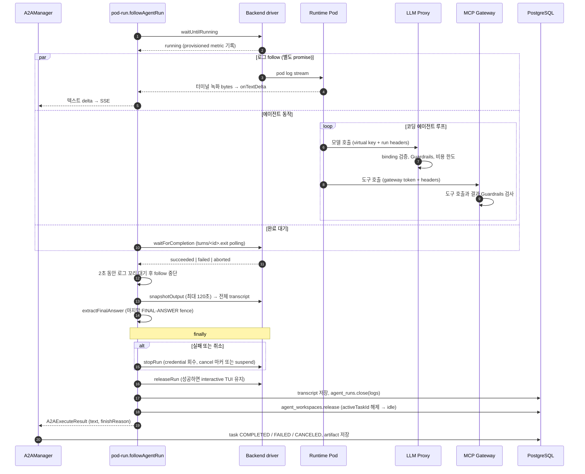
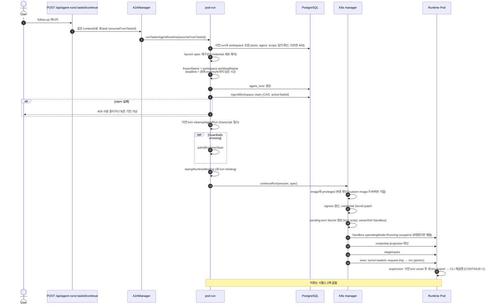
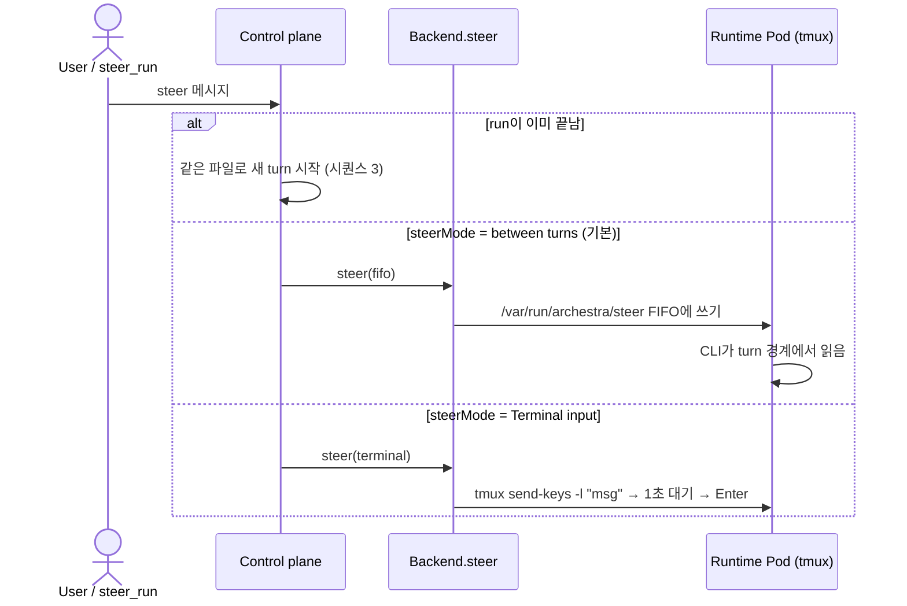
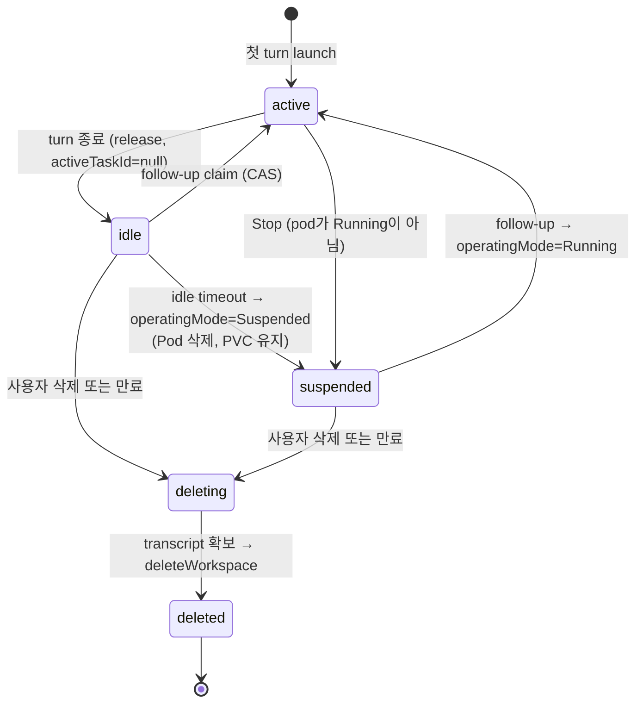
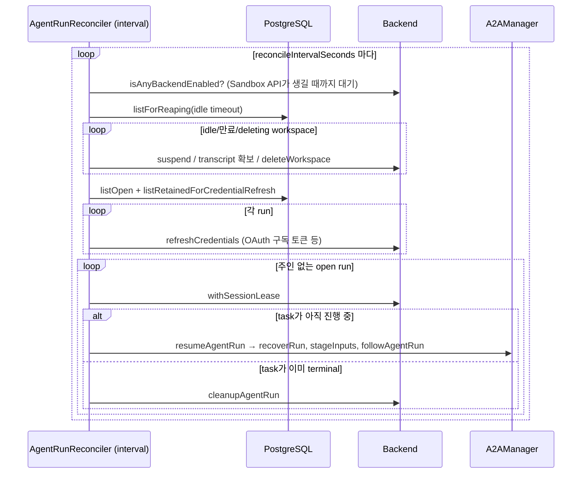
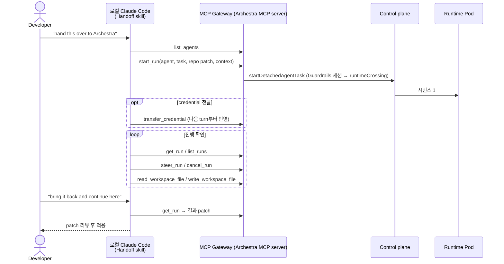

# Archestra Agent Runtime 분석

[Archestra](https://archestra.ai)의 Agent Runtime(Beta)이 어떤 컴포넌트로 구성되고 어떤 순서로 동작하는지 정리한 문서입니다. 우리 쪽 설계([runtime-plan.md](runtime-plan.md))와 비교할 때 참고용입니다.

- 기준: 공식 문서 `docs/pages/agents/runtime/*`와 소스 `archestra-ai/archestra@d2baeb1` (2026-10-22)
- 주요 경로: `platform/backend/src/services/agent-runtime/`, `platform/backend/src/k8s/agent-runtime/`

## 한눈에 보기

- Agent 실행 경로는 두 가지다.
  - **Foreground loop**: 일반 채팅. 플랫폼 프로세스 안에서 LLM ↔ 도구 루프를 돈다 (`executeA2AMessage`).
  - **Dedicated runtime**: Agent에 `runtime`이 설정돼 있고 요청이 **durable task**일 때만 쓴다. 작업마다 격리된 컨테이너에서 Claude Code, Codex, OpenCode, Hermes, OpenClaw 같은 **코딩 에이전트 CLI**를 실행한다.
- 모든 실행은 **A2A Task** 생명주기 위에 올라간다. Runtime은 A2A lifecycle이 주입하는 `executeRun`을 컨테이너 버전으로 바꾼 것뿐이다. 상태 머신, SSE, 취소, push 알림은 그대로 쓴다.
- **Control plane / Backend 분리**: Control plane(Archestra 백엔드)이 identity, credential, 모델, 도구, 한도, 네트워크 정책을 모두 결정한다. Backend는 "명령을 실행하고 출력 스트림을 내고 결과를 보고하는 곳"만 제공한다. 지금 backend는 Kubernetes 하나다 (`kubernetes-sigs/agent-sandbox`의 `Sandbox` CR).
- 컨테이너는 **provider 키를 받지 않는다**. 모델 호출은 LLM Proxy로, 도구 호출은 MCP Gateway로만 나가고, run마다 발급하는 임시 virtual key와 gateway token을 쓴다.
- **Workspace(PVC)는 run보다 오래 산다**. Follow-up은 같은 Sandbox에서 새 turn으로 실행된다. Idle이면 suspend하고, 최대 기간이 지나면 삭제한다.

## 컴포넌트 구성

### Control plane 컴포넌트

| 컴포넌트 | 파일 | 역할 |
|---|---|---|
| Routes | `routes/agent-runtime/agent-runtime.routes.ts` | run 시작/조회/이어가기/취소/삭제, workspace 파일 읽기·쓰기, transfer, credential 등록, Claude Code 계정 연결, preflight |
| startDetachedAgentTask | `services/agent-runtime/start-task.ts` | 모든 진입점이 같이 쓰는 입구. A2A `sendMessage`를 `createTask: true, detached: true`로 호출하고, 첨부파일을 `agent_run_inputs`에 저장한 뒤 task handle을 바로 돌려준다 |
| A2AManager | `agents/a2a/a2a-manager.ts` | `resolveAgentRuntime(agent)`가 있고 `taskId`가 있으면 `runTaskInAgentRuntime`, 아니면 `executeA2AMessage`(foreground)를 탄다. 같은 context의 새 task는 이전 workspace를 재사용한다 |
| pod-run | `services/agent-runtime/pod-run.ts` | 실행 orchestration: 세션 시작 → 실행 대기 → 출력 follow → 완료 대기 → 정리. 실패하면 cleanup도 맡는다 |
| Launch spec builder | `services/agent-runtime/launch-spec.ts` | Backend와 무관한 `AgentRunLaunchSpec`을 만든다. credential 확인, 모델 호환성 preflight, virtual key와 gateway token 발급, env 구성, skill 목록 미리보기 |
| Credentials | `credentials.ts`, `runtime-credentials.ts`, `claude-code-account.ts` | Environment 변수와 secret, 사용자별 credential, Claude Pro/Max 구독, ChatGPT 구독 같은 갱신 가능한(renewable) credential을 해석한다. 없으면 `AgentRuntimeCredentialsRequiredError`를 던져 Chat에서 입력을 받는다 |
| Runtime identity | `runtime-identity.ts` | turn마다 HMAC으로 서명한 `ARCHESTRA_AGENT_RUNTIME_BINDING`을 만든다. Proxy와 Gateway는 이 값으로 요청을 보낸 run을 검증하고 workload principal(`agent-workspace:`)을 붙인다 |
| Runtime crossing | `runtime-crossing.ts` | Guardrails(OpenAPPA) 세션 경계를 넘을 때의 규칙. 부모 세션의 제한을 child run에 바인딩하고(`bindRuntimeChild`), steer를 허용할지 판단하고(`admitRuntimeSteer`), 결과를 부모로 돌려준다 |
| Output capture | `output-capture.ts`, `transcript-store.ts` | 라이브 로그를 스트리밍(`onTextDelta`)하고, 끝나면 snapshot으로 바꿔 전체 transcript를 저장한다. 최종 답은 `===ARCHESTRA-FINAL-ANSWER===` fence 안에서 꺼낸다 |
| Workspace transfers | `workspace-transfers.ts`, `pending-exports.ts` | workspace 파일 업로드·다운로드(스트리밍 snapshot). Guardrails가 도구 호출 중인 파일을 `pending`으로 고정한다 |
| Reconciler | `reconciler.ts` | 주기적으로 실행. 프로세스가 재시작돼 주인이 없어진 run을 다시 붙잡고(`resumeAgentRun`), idle·만료 workspace를 suspend·삭제하고, renewable credential을 갱신한다 |
| Backend registry | `backends/index.ts` | `{ kubernetes }`. 설정된 backend가 없거나 꺼져 있으면 다른 곳으로 넘기지 않고 거절한다 (egress 규칙이 무의미해지므로) |

### Backend 인터페이스 (`AgentRuntimeBackendDriver`)

Kubernetes 객체 이름이 하나도 나오지 않는 runtime 중립 인터페이스입니다. 새 backend(VM, managed sandbox 등)를 추가하려면 구현 파일 하나와 registry 항목 하나만 추가하면 됩니다.

| 분류 | 메서드 |
|---|---|
| 배치·준비 | `resolveRuntimeScope`, `assertReady`, `isEnabled` |
| Turn 실행 | `launch`(첫 turn), `continueRun`(이어가는 turn), `recoverRun`, `stageInputs`, `waitUntilRunning`, `waitForCompletion` → `succeeded \| failed \| aborted` |
| 상호작용 | `streamOutput`, `snapshotOutput`, `steer`, `attach`(WebSocket 터미널), `getStartupProgress` |
| Turn 종료 | `stopRun`(이번 turn만 중단), `releaseRun`(turn 단위 권한 회수), `refreshCredentials` |
| Workspace | `suspendWorkspace`, `resumeWorkspace`, `deleteWorkspace`, `getLastWorkspaceActivity`, `accessWorkspaceFile`, `runWorkspaceTransferCommand`, `readWorkspaceTransferRange` |
| 동시성 | `withSessionLease`: 여러 control-plane replica 사이에서 run의 adoption과 teardown을 직렬화한다 |

`AgentRunLaunchSpec`의 주요 필드: `taskId`, `frozenName`(`agent-run-<slug40>-<id8>`, 실행 전에 고정), `runtimeScope`(namespace), `image`, `command`, `privileged`, `resources`, `env`/`secretEnv`, `renewableCredentials`, `activeDeadlineSeconds`, `workspaceStorageSize/Class`, `nodeSelector`, `imagePullSecrets`, `effectiveNetworkPolicy`, `inputFileCount`, `poolScope`.

### Kubernetes backend 컴포넌트

| 리소스 | 내용 |
|---|---|
| Agent Sandbox controller | 클러스터 운영자가 설치한다 (`agent-sandbox v1.0.1`). CRD: `sandboxes.agents.x-k8s.io`, `sandboxtemplates`, `sandboxwarmpools`, `sandboxclaims`(`extensions.agents.x-k8s.io`). Archestra는 API discovery로 CRD가 있는지 확인하고, 있으면 runtime을 자동으로 켠다 (재시작 불필요) |
| `Sandbox` CR | workspace 하나당 하나. `operatingMode: Running/Suspended`, `shutdownPolicy: Retain`, `service: true`(headless Service로 DNS 유지), `volumeClaimTemplates.workspace`(RWO), `shutdownTime`(= 최대 기간), `podTemplate`(`restartPolicy: Never`, nodeSelector와 같은 키의 toleration) |
| Secret | 초기 env, secret env, `ARCHESTRA_AGENT_RUNTIME_RENEWABLE_CREDENTIALS`. `/var/run/archestra/credentials`에 디렉터리 전체를 마운트한다 (subPath로 마운트하면 갱신이 반영되지 않음). 이어가는 turn은 별도의 pending-turn Secret으로 전달한다 |
| NetworkPolicy | 두 개를 합집합으로 적용한다. (1) Environment egress 정책: MCP server runtime과 같은 builder를 쓰고 Cilium, GKE FQDN, AWS ApplicationNetworkPolicy를 지원한다. (2) Platform egress 정책: runtime pod가 Archestra API, Proxy, Gateway에 항상 닿게 한다 |
| Warm pool | `SandboxWarmPool`과 `SandboxClaim`. 이미지, 리소스, 스토리지, 배치, 네트워크 정책이 같은 Agent끼리 pool을 공유한다. spare에는 credential도 네트워크 접근도 없다. 한 번 할당된 spare는 pool로 돌아가지 않는다. `:latest` 태그는 항상 새로 만든다 |
| Image prefetch (EE) | catalog 이미지를 runtime 노드에 미리 pull한다 |

### Pod 내부 구조 (image contract)

- 이미지에 필요한 것: `/bin/sh`, `PATH`상의 `tmux`, 출력은 stdout/stderr로, 종료 코드 0이면 성공, 보존할 파일은 `/home/node` 아래. `tmux`가 없으면 bootstrap이 exit 78로 끝난다. `python3`는 workspace 파일 기능에만 필요하다.
- **Turn 파일 프로토콜**: `/var/run/archestra/turns/<taskId>.` 뒤에 `request` → `started` → `running` → `result` → `exit`가 차례로 생긴다. 취소는 `cancel` 마커로 한다.
  - Control plane은 `request.tmp`를 쓴 다음 `mv`로 바꿔 넣어(atomic rename) 반쯤 쓰인 요청이 실행되지 않게 한다.
  - Pod가 교체됐을 때 `started`가 이미 있으면 그 turn은 **다시 실행하지 않는다**. 외부 부작용이 이미 일어났을 수 있으므로 `runtime.interrupted`(exit 75)로 실패 처리한다.
  - pane이 죽거나 녹화가 실패하면 `runtime.pane_exited`, `runtime.recording_failed`로 실패 처리한다.
- **Steering**에는 두 방식이 있다. 기본은 turn 경계에서 FIFO로 전달한다. `Terminal input` 모드는 `tmux send-keys`로 입력하는데, 붙여넣기와 Enter를 1초 간격으로 따로 보낸다.
- **활동 감지**: pane 출력이 아니라 사람이 연결한 tmux client의 활동만 `development-activity`에 기록한다. 로그를 계속 찍는 데몬이 idle workspace를 살려 두지 못하게 하기 위해서다.

### 컨테이너에 주입되는 env (일부)

| 변수 | 의미 |
|---|---|
| `ARCHESTRA_LLM_PROXY_URL`, `ARCHESTRA_LLM_PROXY_PROTOCOL` | 모델 호출 대상과 프로토콜 (Anthropic Messages, OpenAI Responses, OpenAI Chat Completions) |
| `ARCHESTRA_VIRTUAL_KEY` | run 전용 임시 virtual key. 사용자 개인 scope로 발급해 비용이 사람에게 귀속된다 |
| `ARCHESTRA_MCP_GATEWAY_URL`, `ARCHESTRA_MCP_GATEWAY_TOKEN` | 도구와 skill을 쓰는 통로 |
| `ARCHESTRA_AGENT_RUNTIME_TASK`, `..._SYSTEM_PROMPT` | 첫 지시와 Agent instructions |
| `ARCHESTRA_AGENT_RUNTIME_TASK_ID`, `..._RUN_ID`, `..._WORKSPACE_ID` | turn, run, workspace 식별자 |
| `ARCHESTRA_AGENT_RUNTIME_BINDING` | turn마다 새로 서명하는 runtime binding (secret env) |
| `ARCHESTRA_AGENT_RUNTIME_MODEL`, `..._MODEL_PROVIDER`, `..._MODEL_CONTEXT_LENGTH` | 고정된 모델 정보 |
| `ARCHESTRA_AGENT_RUNTIME_MODE` | `interactive`(TUI 유지) 또는 `one_shot` |
| `ARCHESTRA_AGENT_RUNTIME_CONTINUE` | 첫 turn이면 `0`, 이어가는 turn이면 `1` |
| `ARCHESTRA_AGENT_RUNTIME_STEER_FIFO`, `..._IDLE_TIMEOUT_SECONDS` | steering 채널과 idle 기준 |

이미지는 Proxy와 Gateway로 가는 모든 요청에 아래 헤더 4개를 붙여야 합니다.

| 헤더 | 값 | 용도 |
|---|---|---|
| `X-Archestra-Run-Id` | `TASK_ID` | turn 하나의 로그를 묶는다 |
| `X-Archestra-Session-Id` | `WORKSPACE_ID` | follow-up을 포함한 대화 전체를 묶는다 |
| `X-Appa-Session-ID` | `WORKSPACE_ID` | Guardrails 세션 이름 |
| `X-Archestra-Runtime-Binding` | `BINDING` | 요청을 보낸 run 증명. Guardrails가 켜져 있으면 없을 때 400 |

### 데이터 모델

- Workspace 수명은 A2A task가 끝난 상태와 상관없다. Agent나 사용자가 삭제돼도 reaper가 인프라를 지울 수 있도록 FK cascade를 걸지 않았다.
- `agent_runs` 행은 **workload를 만들기 전에** 먼저 기록한다. 둘 사이에 크래시가 나도 orphan이 아니라 정리할 수 있는 기록이 남게 하기 위해서다.

## 시퀀스

### 1. 새 run 시작 (첫 turn)

시작이 실패하면 `recordLaunchFailure`가 task를 FAILED로 먼저 확정하고, 그다음 workspace를 `deleting`으로 바꿔 `teardown`한 뒤 `deleted`로 바꿉니다. 정리 자체가 실패하면 run을 열린 상태로 두고 reconciler가 재시도합니다. 순서가 바뀌면 reconciler가 삭제 중인 workspace의 task를 일반적인 사유로 취소해서 실제 오류 메시지를 덮어씁니다.

### 2. 실행 추적과 종료 (followAgentRun)

Run을 끝내는 것은 로그 스트림이 아니라 **backend가 보고한 결과**입니다. 출력 연결은 workload보다 먼저 끊어질 수 있기 때문입니다.

### 3. Follow-up (같은 workspace에서 새 turn)

Follow-up은 deadline을 연장하지 않습니다. Maintained image가 업그레이드되면 다음 turn에서 새 이미지로 재시작하고 파일과 대화는 유지합니다.

### 4. Steering (실행 중인 turn에 끼어들기)

브라우저 터미널은 `attach`가 WebSocket으로 `kubectl exec`처럼 `/var/run/archestra/attach`(= `tmux attach`)를 실행합니다. 연결되기 전에는 `getStartupProgress`가 pod 상태를 사람이 읽을 수 있는 문장으로 바꿔 보여 줍니다(`queued`, `scheduling`, 이미지 pull 등). 터미널에 입력할 수 있는 사람은 run을 시작한 사람뿐입니다.

### 5. 중단(Stop), Idle, 만료, 삭제

| 동작 | 처리 |
|---|---|
| Stop (`/cancel`) | `stopRun`: credential을 먼저 회수한 뒤 `turns/<id>.cancel`을 만들고 `exit`가 생길 때까지 최대 15초 기다린다. pod가 Running이 아니면 Sandbox를 `Suspended`로 바꾼다. 파일과 기록은 유지한다 |
| Idle | 마지막 turn이 끝난 뒤 사람의 터미널 활동이 없으면 reconciler가 suspend한다. 셸 프로세스와 dev server는 사라진다 |
| 만료 | `Sandbox.spec.shutdownTime`에 도달하면 작업 중이어도 종료하고 파일을 삭제한다. 기록은 남는다. 기본값은 `ARCHESTRA_AGENT_RUNTIME_DEFAULT_TTL_HOURS` |
| 삭제 (`DELETE /workspace`) | 활성 turn이 있으면 409. `deleting` 의도를 먼저 DB에 저장한 뒤 cleanup을 진행하고, 실패하면 reconciler가 재시도한다. 취소와 삭제는 별개의 동작이다 (삭제한 파일은 복구할 수 없음) |

### 6. Control plane 재시작 후 재채택 (Reconciler)

`recoverRun`은 pending-turn Secret이 남아 있으면 request를 다시 전달하고, request 파일이 이미 있으면 아무것도 하지 않습니다. 둘 다 없으면 "Resume을 다시 선택하라"는 502를 돌려줍니다. 이미 시작된 turn은 다시 실행하지 않습니다.

### 7. Remote Agent handoff (로컬 코딩 에이전트 → Archestra)

Guardrails 클라이언트로 연결된 세션에서 시작한 run은 그 세션의 제한을 그대로 물려받습니다. 다른 세션은 그 run을 steer하거나 파일을 읽을 수 없습니다(*"This runtime is bound to a different session"*).

## 보안 모델 요약

| 항목 | 방식 |
|---|---|
| Provider 키 | 컨테이너에 넣지 않는다. run마다 virtual key와 gateway token을 발급하고 turn이 끝나면 회수한다 |
| 요청 출처 증명 | turn마다 새로 서명하는 HMAC binding 헤더. 이전 turn의 값은 거절된다 |
| 실행 권한 | 도구는 run을 시작한 사람의 권한으로 실행한다. 입력은 시작한 사람만 할 수 있고, 공유받은 사람은 읽기만 가능하다 |
| 네트워크 | 기본은 인터넷 허용. Environment egress 정책으로 제한할 수 있고 platform egress는 항상 열려 있다 |
| Guardrails | 모든 도구 호출과 결과를 검사한다. 위임된 run은 부모 제한을 상속한다. 승인은 run 소유자만 터미널 카드로 할 수 있다. filesystem과 network sandbox를 대체하지는 않는다 |
| Privileged | `ARCHESTRA_AGENT_RUNTIME_ALLOW_PRIVILEGED=true`이면서 Agent 설정에서도 켜야 한다. 전용 namespace와 node pool을 권장한다 |

## 주요 설정 (환경 변수)

| 변수 | 용도 |
|---|---|
| `ARCHESTRA_ORCHESTRATOR_LOAD_KUBECONFIG_FROM_CURRENT_CLUSTER` / `ARCHESTRA_ORCHESTRATOR_KUBECONFIG` | 클러스터 접근 |
| `ARCHESTRA_AGENT_RUNTIME_PLATFORM_BASE_URL` (또는 `ARCHESTRA_INTERNAL_API_BASE_URL`) | pod에서 Proxy와 Gateway에 접근할 주소. 없으면 시작을 거부한다 |
| `ARCHESTRA_AGENT_RUNTIME_WORKSPACE_STORAGE_CLASS`, `ARCHESTRA_AGENT_RUNTIME_NODE_SELECTOR` | 스토리지와 배치 |
| `ARCHESTRA_AGENT_RUNTIME_DEFAULT_TTL_HOURS` | 최대 기간 기본값 |
| `ARCHESTRA_AGENT_RUNTIME_WARM_POOL_SIZE`, `ARCHESTRA_AGENT_RUNTIME_WARM_POOL_MAX_POOLS` | warm pool (기본 최대 4그룹, 최근 7일 안에 run이 있었던 Agent만) |
| `ARCHESTRA_AGENT_RUNTIME_IMAGE_REGISTRY`, `ARCHESTRA_AGENT_RUNTIME_IMAGE_TAG` | maintained image 위치 |
| `ARCHESTRA_AGENT_RUNTIME_ALLOW_PRIVILEGED` | privileged 컨테이너 허용 |

## 우리 설계와 비교할 때 참고할 점

| 주제 | Archestra | 우리 현재 설계 ([runtime-plan.md](runtime-plan.md)) |
|---|---|---|
| 실행 단위 | A2A Task = turn, Workspace = 여러 turn이 공유하는 파일시스템 | Run = user 메시지 하나 → 최종 응답 |
| 루프 위치 | Foreground는 플랫폼 내부, Dedicated는 컨테이너 안 외부 CLI | 플랫폼 내부 agentic loop + 도구만 sandbox에서 |
| 격리 | K8s Sandbox CR + PVC + NetworkPolicy | 대화마다 Docker 컨테이너 |
| 키 관리 | run별 virtual key, binding 헤더 | 서버 환경변수 키 하나 |
| 장애 복구 | DB 기록을 먼저 남기고, 재시작하면 reconciler가 다시 붙잡고, started turn은 재실행하지 않음 | — |
| 확장성 | `AgentRuntimeBackendDriver` 인터페이스 | — |

참고할 만한 패턴은 세 가지입니다. 하나는 workload보다 DB 행을 먼저 쓰는 것입니다. 다른 하나는 turn request를 atomic rename으로 전달하고, 이미 시작된 turn은 재실행하지 않는 at-most-once 실행입니다. 마지막은 CAS(`activeTaskId`)로 같은 workspace에 동시에 turn이 들어오지 못하게 막는 것입니다.

## 출처

- [Agent Runtime (Beta) 문서](https://archestra.ai/docs/platform-agent-runtime)
- [Platform overview](https://archestra.ai/docs/platform-overview)
- 소스: [archestra-ai/archestra](https://github.com/archestra-ai/archestra) — `docs/pages/agents/runtime/{index,setup,custom-images,handoff}.md`, `platform/backend/src/services/agent-runtime/`, `platform/backend/src/k8s/agent-runtime/`, `platform/backend/src/agents/a2a/a2a-manager.ts`
