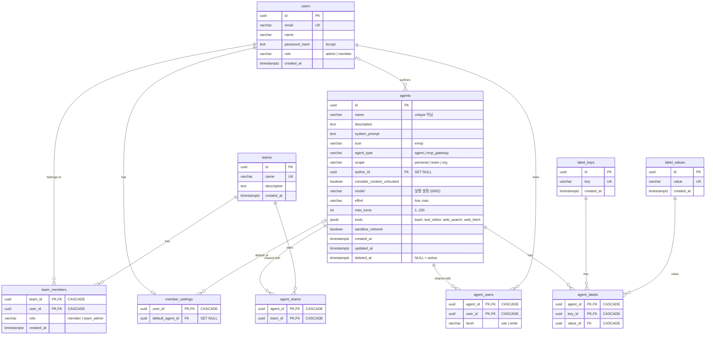
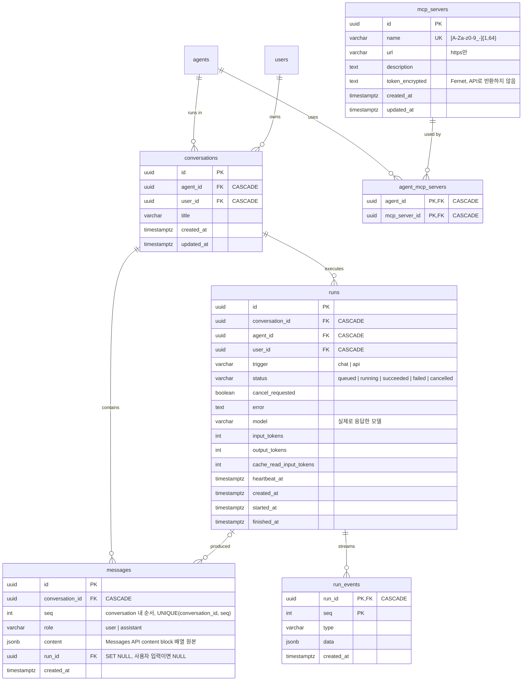
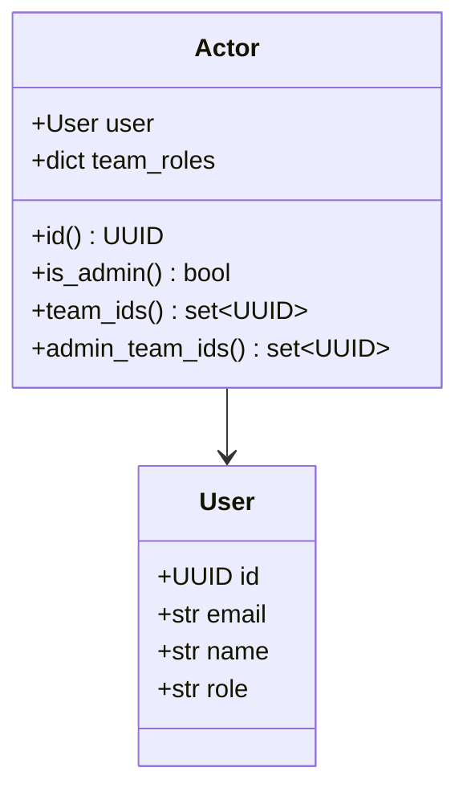
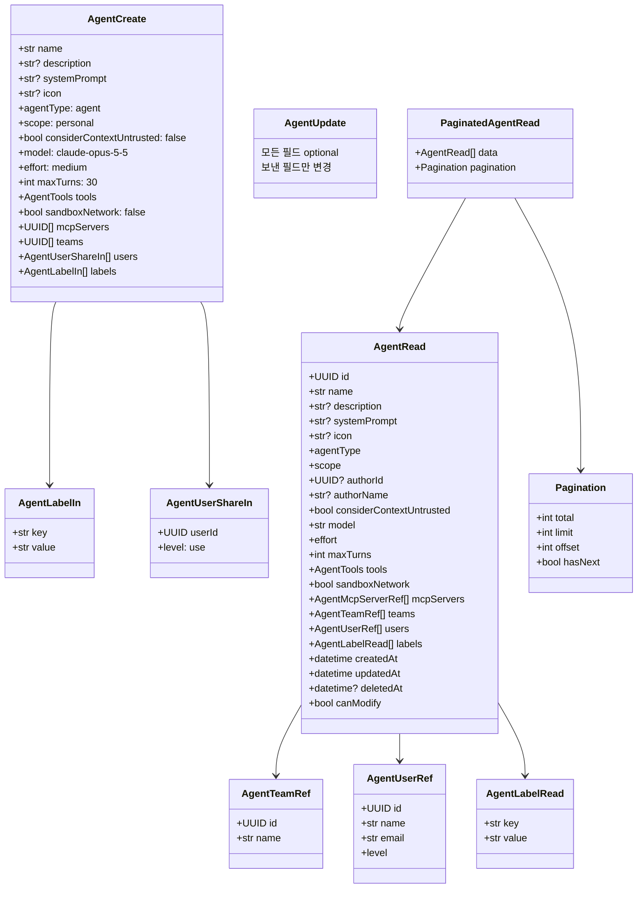
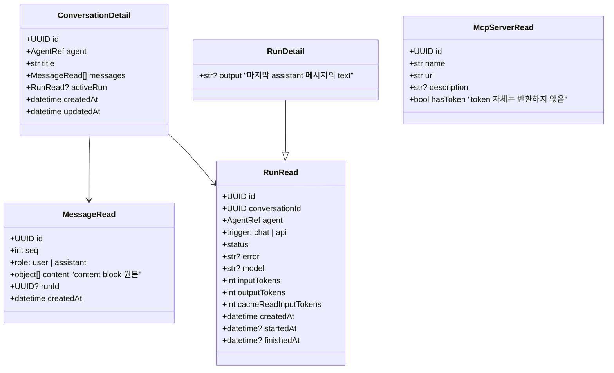

# 데이터 구조

Agent Manager가 다루는 데이터를 계층별로 정리한 문서입니다.

1. [DB 스키마 (ERD)](#1-db-스키마-erd)
2. [백엔드 도메인 객체](#2-백엔드-도메인-객체)
3. [API 모델 (요청/응답)](#3-api-모델-요청응답)
4. [프론트엔드 상태](#4-프론트엔드-상태)

컴포넌트 간 호출 흐름은 [sequence-diagrams.md](sequence-diagrams.md)를 참고하세요.

---

## 1. DB 스키마 (ERD)

정의 위치: `backend/app/models/`, migration: `backend/alembic/versions/0001_initial_schema.py` (실행 환경 테이블은 [아래](#실행-환경-테이블-migration-00020004))



### 테이블별 역할과 제약

| 테이블 | 역할 | 주요 제약 |
|---|---|---|
| `users` | 로그인 사용자. `role=admin`이면 모든 agent를 보고 관리한다 | `email` unique, `role` CHECK |
| `teams` | 팀 | `name` unique |
| `team_members` | 팀 소속. `team_admin`은 그 팀의 team-scope agent를 관리한다 | PK (team_id, user_id), `role` CHECK |
| `member_settings` | 사용자별 설정 (기본 agent) | agent hard delete 시 SET NULL. soft delete 시에는 서비스가 직접 NULL로 만든다 |
| `agents` | Agent 본체 | `scope`, `agent_type` CHECK. 인덱스: scope, author_id, agent_type, deleted_at |
| `agent_teams` | team-scope agent가 공유된 팀 | scope가 `team`일 때만 행이 있다 |
| `agent_users` | personal agent를 공유받은 사용자 | scope가 `personal`일 때만 행이 있다. `level=write`면 수정 가능 |
| `label_keys` / `label_values` | 라벨 키·값 사전. 여러 agent가 공유한다 | 각각 unique. 어떤 agent도 쓰지 않으면 sync 시 삭제(prune) |
| `agent_labels` | agent ↔ (key, value) 연결 | PK (agent_id, key_id) → agent마다 키당 값 하나 |

### 불변식 (서비스 계층이 보장)

- `scope = team` ⇒ `agent_teams` 행이 1개 이상 있다.
- `scope ≠ team` ⇒ `agent_teams` 행이 없다. `scope ≠ personal` ⇒ `agent_users` 행이 없다.
- `scope`는 `personal → team/org`로만 바뀐다. 한 번 공유된 agent는 다시 `personal`이 되지 않는다.
- 활성(`deleted_at IS NULL`) agent 이름은 DB 제약이 없어 중복될 수 있다. 단, restore할 때는 같은 이름의 활성 agent가 있으면 409로 거부한다.

### 삭제 시 연쇄 동작

| 동작 | 결과 |
|---|---|
| agent soft delete | `deleted_at` 설정 + 이 agent를 가리키는 `member_settings.default_agent_id` → NULL |
| agent 영구 삭제 | `agent_teams`, `agent_users`, `agent_labels` CASCADE, `member_settings` SET NULL, 사용되지 않는 라벨 키·값 prune |
| team 삭제 | `team_members`, `agent_teams` CASCADE (그 팀에만 공유된 agent는 admin만 보게 된다) |
| user 삭제 | `team_members`, `agent_users`, `member_settings` CASCADE, `agents.author_id` SET NULL |

### 실행 환경 테이블 (migration 0002–0004)

Agent 실행에 쓰는 테이블입니다. 설계 배경은 [runtime-plan.md](runtime-plan.md)를 참고하세요.



| 테이블 | 역할 | 주요 제약 |
|---|---|---|
| `conversations` | 사용자 한 명과 agent 하나의 대화. 만든 사용자만 볼 수 있다 | 인덱스 (user_id, updated_at) |
| `messages` | 대화 기록. API에 보낸/받은 content block을 그대로 저장한다 | UNIQUE (conversation_id, seq), `role` CHECK |
| `runs` | agent loop 실행 한 번 (user 메시지 → 최종 응답) | `status`, `trigger` CHECK. **partial unique index**: 대화마다 `queued`/`running` Run은 하나뿐 |
| `run_events` | SSE로 보내는 진행 이벤트. `seq`가 SSE의 event id다 | PK (run_id, seq) |
| `mcp_servers` | admin이 등록한 원격 MCP 서버 | `name` unique |
| `agent_mcp_servers` | agent가 쓰는 MCP 서버 | 서버 삭제 시 연결도 CASCADE |

실행 환경의 불변식:

- **대화 기록은 append-only다.** `messages` 행은 수정하거나 지우지 않는다. assistant의 thinking block은 대화에 묶여 있어서, 기록을 바꾸면 다음 요청에서 무효가 된다.
- 마지막 메시지가 `tool_use`를 가진 assistant 메시지인 채로 Run이 끝나지 않는다. 취소나 실패로 도구를 실행하지 못했으면 `finish_run`이 `is_error` tool_result를 채워 넣어서, 대화를 이어갈 수 있게 한다.
- `status`가 `succeeded`/`failed`/`cancelled`가 된 Run은 다시 바뀌지 않는다. `runs.finish`는 `status = 'running'`일 때만 갱신한다.
- `run_finished` 이벤트와 최종 status는 같은 트랜잭션에서 기록된다. 그래서 SSE는 "status가 끝났고 새 이벤트가 없다"를 스트림 종료 조건으로 쓸 수 있다.

| 동작 | 결과 |
|---|---|
| 대화 삭제 | `messages`, `runs`, `run_events` CASCADE. 샌드박스 컨테이너와 volume은 worker의 reaper가 지운다. 활성 Run이 있으면 409 |
| agent 영구 삭제 | 그 agent의 `conversations`(와 하위 전부), `agent_mcp_servers` CASCADE |
| agent soft delete | 대화는 남는다. 읽을 수는 있지만 새 메시지는 404 |
| MCP 서버 삭제 | `agent_mcp_servers` CASCADE (agent에서 자동으로 빠진다) |

---

## 2. 백엔드 도메인 객체

### Actor — 인증된 요청의 주체

`backend/app/services/access.py`. 매 요청마다 `api/deps.py`의 `get_actor`가 만든다.



`team_roles`는 `{team_id: "member" | "team_admin"}` 형태입니다. 접근제어는 모두 이 객체 하나로 판단합니다.

### 접근제어 규칙 — SQL 조건과 Python 판정

같은 규칙이 두 가지 형태로 있습니다. 목록·단건 조회는 SQL 조건으로 걸러내고, 응답의 `canModify`는 Python 함수로 계산합니다. 둘은 항상 같은 결과를 내야 합니다.

| 함수 | 형태 | 용도 |
|---|---|---|
| `visible_agents_clause(actor)` | SQL `WHERE` 조건 | 볼 수 있는 agent (목록, 단건 조회) |
| `modifiable_agents_clause(actor)` | SQL `WHERE` 조건 | 수정·삭제·복원 가능한 agent, Deleted 목록 |
| `can_modify(actor, agent, ...)` | Python bool | 응답의 `canModify` 필드 |

| scope | visible | modifiable |
|---|---|---|
| `personal` | 작성자, `agent_users`에 있는 사용자 | 작성자, `agent_users.level = write`인 사용자 |
| `team` | `agent_teams`의 팀 중 하나에 속한 사용자 | 그 팀 중 하나의 `team_admin` |
| `org` | 모든 사용자 | admin만 |
| (모든 scope) | admin은 전부 | admin은 전부 |

### AgentListFilters — 목록 조회 조건

`backend/app/repositories/agent.py`. API 쿼리 파라미터를 파싱한 결과입니다.

| 필드 | 타입 | 출처 (쿼리 파라미터) |
|---|---|---|
| `name` | `str \| None` | `name` (대소문자 무시 부분 일치, `%`·`_`는 문자 그대로 매칭) |
| `agent_type` | `str \| None` | `agentType` |
| `scope` | `str \| None` | `scope` |
| `team_ids` | `list[UUID]` | `teamIds` (쉼표 구분) |
| `labels` | `dict[str, list[str]]` | `labels` (`env:prod\|dev` 형식, 키 사이는 세미콜론으로 구분) — 키끼리 AND, 값끼리 OR |
| `deleted` | `bool` | `status=deleted` |
| `limit` / `offset` | `int` | `limit` (1–100, 기본 20) / `offset` |
| `sort_by` / `sort_direction` | `str` | `sortBy` (`name` \| `createdAt` \| `team`) / `sortDirection` |

---

## 3. API 모델 (요청/응답)

정의 위치: `backend/app/schemas/`. JSON 필드는 camelCase, Python은 snake_case입니다 (`CamelModel`). 프론트엔드 타입(`frontend/src/lib/api/schema.d.ts`)은 이 모델에서 생성됩니다.



### 실행 환경 API 모델

정의 위치: `backend/app/schemas/runtime.py`



| 요청 | 본문 | 응답 |
|---|---|---|
| `POST /api/conversations` | `{agentId, title?}` | `ConversationRead` (201) |
| `POST /api/conversations/{id}/messages` | `{content}` | `{message, run}` (201). 활성 Run이 있으면 409 |
| `POST /api/agents/{id}/runs` | `{input}` | `RunRead` (202). 새 대화를 만들고 큐에 넣는다 |
| `GET /api/runs/{id}` | — | `RunDetail` |
| `POST /api/runs/{id}/cancel` | — | `RunRead`. 끝난 Run이면 409 |
| `GET /api/runs/{id}/events` | — | `text/event-stream`. `?after=seq` 또는 `Last-Event-ID`로 이어받는다 |
| `POST /api/mcp-servers` (admin) | `{name, url, description?, token?}` | `McpServerRead` (201) |
| `PUT /api/mcp-servers/{id}` (admin) | 보낸 필드만 변경. `token: null`이면 token 제거 | `McpServerRead` |

SSE 이벤트 (`event:` 이름 → `data:` JSON):

| 이벤트 | data | 의미 |
|---|---|---|
| `run_started` | `{model}` | worker가 실행을 시작했다 |
| `thinking_delta` / `text_delta` | `{text}` | 현재 턴의 출력 조각 (약 100ms 단위로 묶임) |
| `turn_reset` | `{}` | 지금까지 스트리밍한 현재 턴 출력을 버린다 (fallback 모델로 전환, 거절) |
| `message` | `{messageId}` | 메시지 하나가 DB에 저장됐다 |
| `tool_call` / `tool_result` | `{id, name, input}` / `{id, output, isError}` | client 도구 실행 |
| `usage` | `{model, inputTokens, outputTokens, cacheReadInputTokens}` | 누적 토큰 사용량 |
| `run_finished` | `{status, error}` | Run 종료 (DB에 저장되는 마지막 이벤트) |
| `done` | `{status}` | 스트림 종료 (저장되지 않음, id 없음) |

### 입력 검증

| 대상 | 규칙 | 실패 시 |
|---|---|---|
| `name` | 1–200자 | 400 |
| `labels` | 키 중복 불가, 키·값 앞뒤 공백 제거 후 1자 이상 | 400 |
| `AgentUpdate`의 `name`, `agentType`, `scope`, `considerContextUntrusted` | 명시적 `null` 불가 (`description` 등 nullable 필드는 `null`로 지울 수 있다) | 400 |

### `AgentRead`가 만들어지는 방식

`agents` 행만으로는 응답을 만들 수 없어서 `services/agent.py`의 `hydrate()`가 연관 데이터를 붙입니다. 목록 크기와 상관없이 **배치 쿼리 4번**으로 끝납니다 (N+1 방지).

| 필드 | 출처 |
|---|---|
| `teams` | `agent_teams` ⨝ `teams` |
| `users` | `agent_users` ⨝ `users` |
| `labels` | `agent_labels` ⨝ `label_keys` ⨝ `label_values`, key 순 정렬 |
| `authorName` | `users` (author_id 묶음 조회) |
| `canModify` | 위 결과 + `Actor`로 `can_modify()` 계산 (쿼리 없음) |

### 에러 응답

모든 에러는 같은 형태입니다 (`backend/app/errors.py`).

```json
{ "error": { "message": "Agent not found", "type": "api_not_found_error" } }
```

| status | type | 대표 상황 |
|---|---|---|
| 400 | `api_validation_error` | 입력 검증 실패, team scope인데 팀 없음, 공유 agent를 personal로 변경 |
| 401 | `api_authentication_error` | 토큰 없음/만료, 로그인 실패 |
| 403 | `api_authorization_error` | 비admin이 org scope 지정, 관리하지 않는 팀 지정 |
| 404 | `api_not_found_error` | 없는 agent, **볼 수는 있지만 수정 권한이 없는 agent** (존재 여부 노출 방지) |
| 409 | `api_conflict_error` | restore 시 같은 이름의 활성 agent 존재, 중복 이메일·팀 이름 |

---

## 4. 프론트엔드 상태

### TanStack Query 캐시 키

서버 데이터는 모두 TanStack Query 캐시에 있습니다 (`frontend/src/lib/queries/`).

| 키 | 데이터 | 무효화 시점 |
|---|---|---|
| `["me"]` | 로그인 사용자 + 팀 역할 | 로그인/로그아웃 (전체 clear), 팀 멤버십 변경 |
| `["agents", "list", params]` | 페이지 단위 agent 목록 | agent 생성·수정·삭제·복원·영구 삭제, 팀 변경 |
| `["agents", "detail", id]` | agent 단건 | 위와 같음 (`["agents"]` 접두사로 함께 무효화) |
| `["agents", "all"]` | 볼 수 있는 활성 agent 전체 | 위와 같음 |
| `["agents", "labels", ...]` | 라벨 키·값 자동완성 | 위와 같음 |
| `["members", "default-agent"]` | 내 기본 agent id | 기본 agent 변경 (응답으로 직접 갱신), agent 변경 |
| `["teams"]`, `["users"]` | 팀(멤버 포함), 사용자 목록 | 팀·멤버·사용자 변경 |
| `["conversations", "list"]` | 내 대화 목록 (사이드바) | 대화 생성·삭제, 메시지 전송, Run 종료 |
| `["conversations", "detail", id]` | 대화 + 메시지 + 활성 Run | 메시지 전송, SSE의 `message`/`run_finished` 이벤트 (refetch) |
| `["runs", "list", params]` | Run 이력 | Run 종료, 대화 삭제. 활성 Run이 있으면 3초마다 refetch |
| `["mcp-servers"]` | MCP 서버 목록 | MCP 서버 추가·삭제 (agent 캐시도 함께) |

### URL 상태 — Agent 목록

필터·정렬·페이지는 URL 쿼리에 저장됩니다. 새로고침해도 유지되고 링크로 공유할 수 있습니다 (`components/agents/agents-list-page.tsx`의 `useUrlState`).

| URL 파라미터 | 의미 | API로 전달 |
|---|---|---|
| `name` | 검색어 (300ms debounce) | `name` |
| `scope` | 공개 범위 필터 | `scope` |
| `team` | 팀 필터 | `teamIds` |
| `labels` | 라벨 필터 (API와 같은 형식) | `labels` |
| `status=deleted` | Deleted 탭 | `status` |
| `sortBy`, `sortDirection` | 정렬 | 그대로 |
| `page` | 0부터 시작 | `offset = page × 20` |

### 그 외 클라이언트 상태

| 상태 | 위치 | 설명 |
|---|---|---|
| 액세스 토큰 | `localStorage["agent-manager.token"]` (`lib/auth.ts`) | 변경 시 구독자에게 알린다. `AppShell`이 구독해서 토큰이 사라지면 `/login`으로 보낸다 |
| 실행 중인 Run의 출력 | `useRunStream` (`components/chat/use-run-stream.ts`) | 아직 저장되지 않은 현재 턴의 thinking/text와 도구 결과. 서버가 메시지를 저장하면(`message` 이벤트) 대화를 다시 불러온 뒤 비운다 |
| Agent 폼 값 | react-hook-form + zod (`components/agents/agent-form.tsx`) | 제출 시 서버 규칙 일부(팀 1개 이상, 라벨 키 중복)를 미리 검사한다. 최종 판단은 서버가 한다 |
