# Dify Agent Runtime 분석

[Dify](https://github.com/langgenius/dify)가 Agent를 어떤 컴포넌트로 실행하고 어떤 순서로 동작하는지 정리한 문서입니다. [archestra-agent-runtime.md](archestra-agent-runtime.md), 우리 설계([runtime-plan.md](runtime-plan.md))와 비교할 때 참고용입니다.

- 기준: `langgenius/dify@0d06488`, `langgenius/dify-plugin-daemon@b5217db`, `langgenius/dify-sandbox@1b501ff` (모두 2026-10-22)
- 주요 경로: `dify-agent/`(Agent backend 서비스), `dify-agent-runtime/`(샌드박스 안의 Go 바이너리), `api/core/app/apps/agent_app/`, `api/core/workflow/nodes/agent_v2/`, `api/controllers/inner_api/agent/`

## 한눈에 보기

Dify에는 Agent 실행 방식이 **세 세대**로 공존합니다.

| 세대 | 쓰는 곳 | 루프가 도는 곳 | 실행 환경 |
|---|---|---|---|
| ① Legacy Agent Chat | 예전 "Agent" 앱 (EasyUI) | Dify API 프로세스 안 (`FunctionCallAgentRunner`, `CotAgentRunner`) | 없음. 도구만 호출 |
| ② Agent Strategy 플러그인 | Workflow의 `agent` 노드 | **plugin daemon**이 띄운 플러그인 프로세스 (ReAct, Function Calling 등을 플러그인으로 배포) | plugin runtime (local subprocess, debug, serverless) |
| ③ **Dify Agent (Agent v2)** | Agent App, Workflow `agent_v2` 노드, Agent Roster | **별도 서비스 `dify-agent`** (FastAPI + Pydantic AI) | **Execution Binding**: shellctl이 도는 샌드박스 (Local, E2B, OpenShell, Enterprise) |

이 문서는 ③을 중심으로 다룹니다. 이번에 말하는 "Agent runtime"은 ③에 해당합니다.

③의 핵심:
- **Dify API는 ledger, Dify Agent는 stateless 실행기**입니다. Agent, Config, Workspace, Binding, 세션 snapshot은 모두 Dify API의 PostgreSQL에 저장합니다. Dify Agent는 제품 DB에 접근하지 않고, 실행 상태와 이벤트만 Redis에 2시간 동안 보관합니다.
- 실행 하나를 **Run**이라고 부르고, `POST /runs` 요청에 **RunComposition**(모듈 이름 + JSON Config 목록)과 이전 **SessionSnapshot**을 함께 보냅니다. 서버는 모듈마다 Pydantic AI `Capability` 또는 `Toolset`을 새로 만들어 `agent.run()`을 돌립니다.
- 루프는 Dify Agent 프로세스 안에서 돕니다(Pydantic AI). 샌드박스에서는 **shell 도구가 내린 명령만** 실행합니다. Archestra처럼 코딩 에이전트 CLI 전체를 컨테이너에 넣는 구조가 아닙니다.
- 모델 키는 샌드박스와 Dify Agent 어디에도 없습니다. 모델 호출은 Dify API의 inner gateway(`/inner/api/agent/llm/invoke`)를 거쳐 plugin daemon의 모델 플러그인으로 갑니다. 이 경로에서 과금과 사용량을 기록합니다.
- 리소스는 세 층으로 나뉩니다. **Home Snapshot**(불변 Home), **Workspace**(제품 scope마다 하나인 가변 작업 공간), **Execution Binding**(Agent 참가자 하나와 그 private Home 및 세션)입니다. 실행할 때는 operation 단위 **RuntimeLease**로만 접근합니다.

## 컴포넌트 구성

```mermaid
flowchart LR
    subgraph Client["진입점"]
        Web["Web App / Console<br/>Agent App 채팅, Build Draft 디버그"]
        WF["Workflow 실행<br/>agent_v2 노드"]
        SvcAPI["Service API"]
    end

    subgraph API["Dify API (Flask + Celery)"]
        AAR["AgentAppRunner<br/>core/app/apps/agent_app"]
        WFN["DifyAgentNode<br/>core/workflow/nodes/agent_v2"]
        RRB["runtime_request_builder<br/>RunComposition 조립"]
        SS["session_store<br/>Binding 해석/생성, snapshot 저장"]
        ABC["clients/agent_backend<br/>AgentBackendRunClient"]
        Inner["inner_api/agent/*<br/>llm, tools, files, tracing, sandbox-usage"]
        Celery["Celery: collect_agent_resources<br/>(retention queue)"]
        Beat["Celery Beat:<br/>collect_agent_sandbox_usage"]
    end

    PG[("PostgreSQL<br/>agents, agent_config_*,<br/>agent_workspaces,<br/>agent_workspace_bindings,<br/>agent_home_snapshots")]

    subgraph DA["Dify Agent (FastAPI, :5050)"]
        Runs["/runs<br/>create, status, cancel, events, SSE"]
        Sched["RunScheduler<br/>프로세스 로컬 asyncio task"]
        Runner["AgentRunRunner<br/>Pydantic AI agent.run"]
        Layers["Modules (layers)<br/>execution_context, llm, tools,<br/>core_tools, knowledge, runtime,<br/>shell, config, history, output, prompt"]
        EB["/execution-bindings<br/>/home-snapshots<br/>/execution-bindings/files/*"]
        Stub["/agent-stub/*<br/>샌드박스 콜백 (JWE token)"]
        Prof["RuntimeBackendProfile<br/>local | e2b | openshell | enterprise"]
    end

    Redis[("Redis<br/>run record + event stream")]

    subgraph SB["Sandbox (Execution Binding)"]
        Shellctl["shellctl serve :5004<br/>jobs API, snapshot API"]
        Tmux["tmux + runner<br/>Landlock path isolation"]
        CLI["dify-agent CLI<br/>file / config / skills"]
        Home[("$HOME<br/>/home/dify/...")]
        WS[("Workspace<br/>/workspace/... = cwd = TMPDIR")]
    end

    PD["dify-plugin-daemon<br/>model, tool 플러그인"]
    SSRF["agent_ssrf_proxy (squid)"]

    Web --> AAR
    SvcAPI --> AAR
    WF --> WFN
    AAR --> RRB
    WFN --> RRB
    AAR --> SS --> PG
    RRB --> ABC
    ABC -- "HTTP + SSE<br/>Bearer AGENT_BACKEND_API_TOKEN" --> Runs
    SS -- "Binding 생성" --> EB
    Celery -- "destroy" --> EB
    Runs --> Sched --> Runner --> Layers
    Runner --> Redis
    Layers -- "llm" --> Inner
    Layers -- "core_tools, knowledge" --> Inner
    Layers -- "plugin tools<br/>dispatch/tool/invoke" --> PD
    Inner -- "model invoke" --> PD
    Layers -- "runtime: acquire/release lease" --> Prof
    Prof -- "shell job, file" --> Shellctl
    Shellctl --> Tmux --> CLI
    Tmux --- Home
    Tmux --- WS
    CLI -- "HTTP(S)" --> Stub
    CLI -- "signed /files/* bytes" --> API
    Tmux -- "egress" --> SSRF
```

### Dify API 쪽 컴포넌트

| 컴포넌트 | 파일 | 역할 |
|---|---|---|
| AgentAppRunner | `core/app/apps/agent_app/app_runner.py` | Agent App 대화의 turn 하나를 실행한다. session scope → Binding 해석 → RunComposition 조립 → `create_run` → SSE 소비 → 답변과 사용량 저장 → session snapshot 저장 |
| DifyAgentNode | `core/workflow/nodes/agent_v2/agent_node.py` | Workflow 노드. 고정된 node job을 실행하고 성공하면 `switch` 출력으로 다음 경로를 고른다. Engine의 abort 상태를 SSE 소비 중에도 확인한다 |
| Runtime request builder | `agent_app/runtime_request_builder.py`, `agent_v2/runtime_request_builder.py` | Agent Soul(config)을 모듈 목록과 Config로 바꾼다. 도구 선언과 schema를 미리 준비하고 `plugin_unique_identifier`로 버전을 고정한다 |
| Session store | `agent_app/session_store.py` | 대화, Build Draft, Workflow 실행 같은 product scope에 묶인 Binding을 찾는다. 없으면 생성하고 같은 트랜잭션에서 저장한다. **최근 Binding을 찾아 대신 쓰는 fallback은 없다** |
| AgentBackendRunClient | `clients/agent_backend/client.py` | `dify-agent` 공개 클라이언트를 감싼 동기 래퍼. `create_run`, `cancel_run(_and_wait)`, `stream_events`, `wait_run`. 테스트용 fake도 있다 |
| Inner API | `controllers/inner_api/agent/*` | Dify Agent가 호출하는 신뢰 경로. `llm/invoke`(과금 gateway), `tools/invoke`(core tool), `files/upload-request` 및 `download-request`(서명 URL), `tracing/batches`, `sandbox-usage/*` |
| 리소스 수거 | `tasks/collect_agent_resources_task.py` | RETIRED 상태가 된 Binding, Workspace, Home Snapshot의 물리 리소스를 Dify Agent에 destroy 요청하고, 성공하면 ledger 행을 지운다 |
| Sandbox 사용량 | `schedule/collect_agent_sandbox_usage.py`, `models/agent_sandbox_usage.py` | E2B 실행 시간을 별도로 기록한다 |

### Dify Agent 서비스 컴포넌트

| 컴포넌트 | 파일 | 역할 |
|---|---|---|
| Server | `server/app.py`, `server/settings.py` | FastAPI lifespan에서 Redis run store, plugin daemon과 inner API용 공유 `httpx` client, backend profile, scheduler를 만든다. 설정은 `DIFY_AGENT_*` |
| Runs routes | `server/routes/runs.py` | `POST /runs`(202), `GET /runs/{id}`, `POST /runs/{id}/cancel`, `GET /runs/{id}/events`(cursor polling), `GET /runs/{id}/events/sse` |
| RunScheduler | `runtime/run_scheduler.py` | 받은 run을 **같은 프로세스의 asyncio task**로 실행한다. 큐, 재시도, worker handoff가 없다. 취소 의도를 관찰하고, shutdown할 때 grace period 동안 기다린다 |
| AgentRunRunner | `runtime/runner.py` | 실행 전에 Config, State, 모듈 참조를 검증하고 native 컴포넌트를 만든 뒤 `agent.run()`을 실행한다. finally에서 history를 저장하고 terminal snapshot을 만든다. 모델 요청은 최대 500 step, 벽시계 기준 `DIFY_AGENT_RUN_TIMEOUT_SECONDS`(3600) 제한 |
| Event pipeline | `runtime/event_sink.py`, `event_coalescer.py`, `storage/redis_run_store.py` | `run_started` → `pydantic_ai_event`* → `run_succeeded`, `run_failed`, `run_cancelled` 중 정확히 하나. text delta는 100ms 또는 4096자 단위로 합친다. terminal 전환은 Redis Lua로 원자적으로 처리한다 |
| Modules (layers) | `layers/*` | 모듈마다 `Config`, `State`, native `Capability` 또는 `Toolset`이 하나씩 있다. 아래 표 참고 |
| Runtime backends | `runtime_backend/{local,e2b,openshell,enterprise}.py` | `ExecutionBindingBackend`(create, acquire, release, destroy)와 `HomeSnapshotBackend`(create_from_runtime, delete)를 구현한다. 배포마다 하나를 고른다 |
| Control-plane routes | `server/routes/{execution_bindings,home_snapshots,binding_files}.py` | Dify API만 호출한다. Binding 생성과 삭제, Home snapshot 생성과 삭제, Binding 파일 목록, 읽기, 다운로드 |
| Agent Stub | `agent_stub/server/*` | 샌드박스 안의 `dify-agent` CLI가 호출하는 좁은 HTTP API. 연결, 파일 업로드·다운로드 요청, config manifest, skill push·pull, note |

### 모듈 (RunComposition의 layer)

| 이름 | 종류 | 역할 |
|---|---|---|
| `execution_context` | Capability | tenant, user, app, invoke_from 식별자와 correlation ID, 선택적인 application tracing context. 다른 모듈이 이름으로 참조한다 |
| `llm` (필수) | Model | plugin_id, provider, model, settings, context window. Dify API의 과금 gateway를 거쳐 모델을 만든다 |
| `tools` | Toolset | API가 준비한 plugin tool 선언. plugin daemon `/plugin/{tenant}/dispatch/tool/invoke`를 직접 호출하고 `X-Plugin-Unique-Identifier`로 정확한 버전을 실행한다 |
| `core_tools` | Toolset | Dify 내장 도구. `/inner/api/agent/tools/invoke`로 실행한다 |
| `knowledge` | Capability | 데이터셋 검색. 미리 가져온(eager) 결과는 user role로 주입한다 |
| `runtime` | Capability | `backend_binding_ref`만 받는다. `wrap_run`에서 lease를 acquire하고 finally에서 release한다 |
| `shell` | Capability + Toolset | `shell_run`, `shell_wait`, `shell_input`, `shell_interrupt`. 최초 1회 bootstrap하고, 종료할 때 추적하던 job을 제거하고 credential을 지운다 |
| `config` | Capability | Agent Soul에 첨부된 파일과 skill을 처음 초기화할 때 샌드박스로 pull한다 |
| `history` | State | 대화 메시지. 실패나 취소 시에도 저장하고, instructions는 빼고 저장한다 |
| `output` | Capability | structured output 계약 |
| `agent_soul_prompt`, `workflow_node_job_prompt`, `workflow_user_prompt`, `agent_app_user_prompt` 등 | Prompt | system instructions와 사용자 입력. 텍스트와 이미지(multimodal), 다운로드용 첨부 |

Native capability는 **Runtime → Shell → Config** 순서로 resource scope를 엽니다. Lease가 먼저 있어야 shell을 bootstrap할 수 있고, config pull이 가능합니다.

SessionSnapshot v2는 **State만** 저장합니다.

```json
{"schema_version": 2, "layers": {"history": {"messages": []}, "shell": {"initialized": true, "job_ids": [], "job_offsets": {}}}}
```

Config, client, lease, token, model 객체는 snapshot에 넣지 않습니다. API는 매 turn마다 **현재 Config와 이전 snapshot**을 함께 보냅니다. 모듈은 turn 사이에 추가하거나 뺄 수 있고, State는 이름으로 매칭됩니다.

### Runtime backend

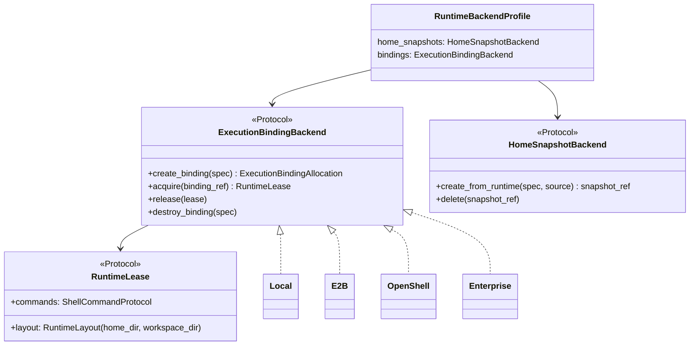

| Backend | 물리 구조 | Home Snapshot | Workspace 공유 | 비고 |
|---|---|---|---|---|
| **Local** (기본) | shellctl daemon **하나**를 모든 Binding이 같이 쓴다. Home(`/home/dify/<binding>`)과 Workspace(`/workspace/<ws>`)가 별도 디렉터리 | 디렉터리 복사 | 가능. 여러 Binding이 Workspace 하나를 공유 | 격리는 Landlock 경로 제한에 의존한다. binding ref에 경로 segment를 인코딩해서 adapter가 stateless로 동작한다 |
| **E2B** | Binding 하나 = E2B Sandbox 하나 (Workspace 포함) | E2B 네이티브 snapshot (`mode="full"`, 메모리 포함) | 불가 (`shared_workspace_unsupported`) | release하면 **pause**(메모리 유지)하고, acquire하면 `on_resume="restore"`. 연속 활성 시간은 최대 3600초. 생성 요청은 재시도하지 않는다 |
| **OpenShell** | Binding 하나 = OpenShell sandbox 하나 (이름으로 식별) | 운영자가 제공한 공유 볼륨에 디렉터리 복사 | 불가 | acquire할 때 exec로 shellctl을 bootstrap하고 lease마다 TCP 터널을 연다. `egress_allow`를 설정하면 egress를 제한한다. 운영 환경에서는 tenant마다 workspace와 볼륨을 따로 쓴다 |
| **Enterprise** | Gateway가 sandbox를 할당한다 (Binding과 Workspace가 함께 묶임) | 미지원 | 불가 | shellctl은 Gateway proxy를 거친다 |

### 샌드박스 내부 (`dify-agent-runtime`, Go)

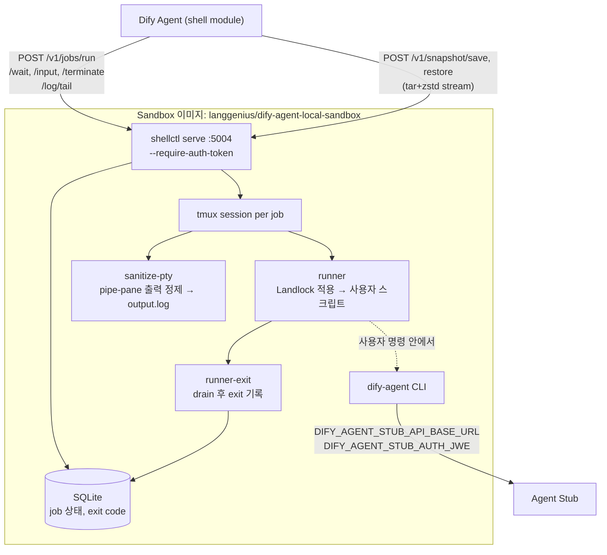

| 항목 | 내용 |
|---|---|
| Job API | `POST /v1/jobs/run`(mode `pty` 기본: stdout과 stderr를 합치고 `/input` 가능 / `stdio`: 출력을 분리하는 기계용 모드), `GET /v1/jobs`, `GET /v1/jobs/{id}`, `POST /v1/jobs/{id}/wait`, `/input`, `/terminate`, `GET /v1/jobs/{id}/log/tail`, `DELETE /v1/jobs/{id}` |
| Snapshot API | `POST /v1/snapshot/save`: `$HOME`을 tar+zstd로 스트리밍한다. 성공 여부는 trailer `X-Snapshot-Status: ok`, `X-Snapshot-Sha256`, `X-Snapshot-Bytes`로 알린다. `POST /v1/snapshot/restore`: `os.Root`로 경로 탈출을 차단하지만 트랜잭션이 아니므로 실패하면 샌드박스를 새로 만들어야 한다. 한 번에 하나만 실행된다 (`409 snapshot_busy`) |
| Path isolation (Landlock) | RW: `$HOME`, job `cwd`(= TMPDIR). RO+Exec: `/usr`, `/bin`, `/lib`, `/etc`, `/proc`, `/opt/dify-agent-tools` 등. 나머지(`/tmp`, 다른 agent의 Home, `/var`)는 거부한다. Linux 5.13 이상 필요. 설정에 실패하면 exit 125로 실행을 막는다 |
| 인증 | `SHELLCTL_AUTH_TOKEN`이 Dify Agent의 `DIFY_AGENT_LOCAL_SANDBOX_AUTH_TOKEN`과 같아야 한다 |
| 네트워크 (Compose) | `local_sandbox`는 `agent_sandbox_network`(agent_backend와 통신)와 `local_sandbox_proxy_network`에만 붙는다. egress는 `HTTP(S)_PROXY=agent_ssrf_proxy:3128`(squid)로 나간다 |
| `dify-agent` CLI | `connect`, `file upload/download/public-url`, `config manifest`, `config skills pull/push/delete`, `config files pull`. 명령은 Agent Stub으로 가고, 파일 바이트는 Dify API `/files/*`의 서명 URL로 직접 주고받는다 |

Agent Stub 토큰은 `DIFY_AGENT_SERVER_SECRET_KEY`에서 HKDF로 키를 유도한 **compact JWE**이고, 유효 시간은 5분입니다. shell 도구를 호출할 때마다 env로 주입되며, 만료되면 *"start a new shell tool call and retry"* 오류를 돌려줍니다.

### 데이터 모델 (Dify API)

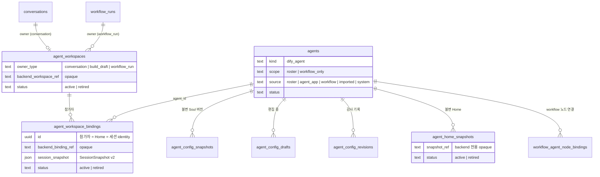

- Backend ref는 해당 backend adapter만 해석할 수 있는 opaque 문자열입니다. Dify API는 lease, SDK 객체, 임시 토큰을 저장하지 않습니다.
- Agent 하나가 Workspace 하나에 Binding을 여러 개 가질 수 있습니다. Binding마다 Home과 세션은 독립적이고 Workspace 파일만 공유합니다(Local backend).

## 시퀀스

### 1. Agent App 대화 turn

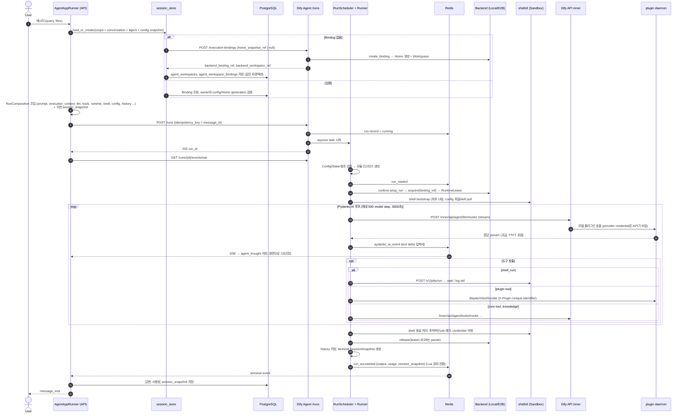

- `binding_lost`로 실패하면 *"The retained agent working environment is no longer available"*로 끝나고, 대체 Workspace를 새로 만들지 않습니다.
- 실패하거나 취소돼도 snapshot이 있으면 저장합니다. snapshot이 없으면 이전 snapshot을 그대로 둡니다.

### 2. Workflow `agent_v2` 노드

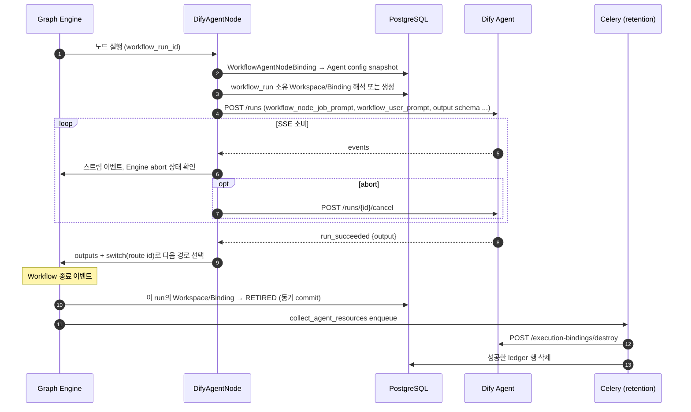

### 3. 취소

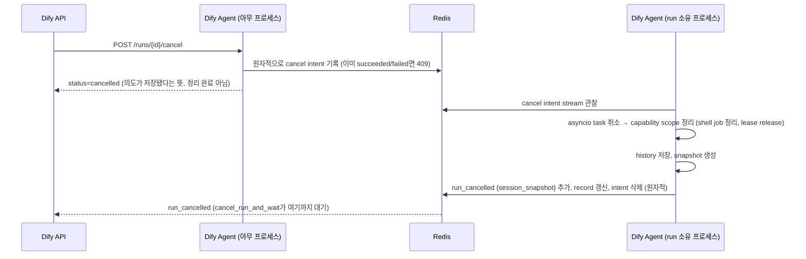

먼저 받아들여진 success, failure, cancel intent 하나만 terminal이 됩니다. 프로세스가 비정상 종료되면 run은 `running`으로 남고, 복구 장치는 없습니다.

### 4. Build Draft 적용 (Home Snapshot 생성)

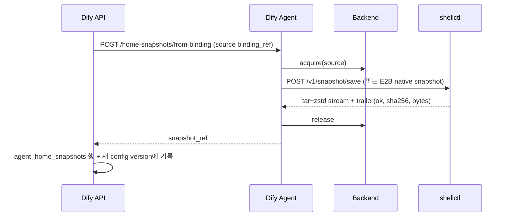

Source Binding이 없으면 바로 실패합니다. 재생이나 fallback은 없습니다.

### 5. Binding 파일 열람과 다운로드

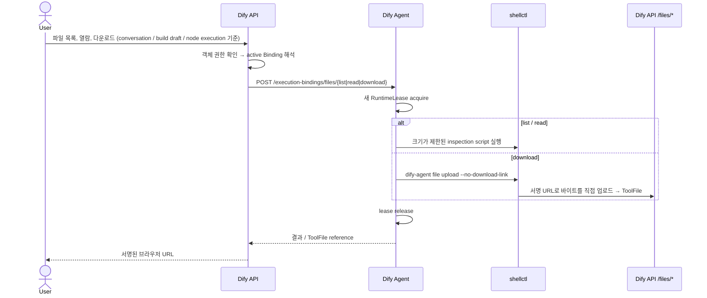

다운로드 timeout은 바깥 계층일수록 깁니다: sandbox CLI 180초 < Dify Agent 명령 210초 < API 240초.

### 6. 리소스 수명 (Retire와 Collect)

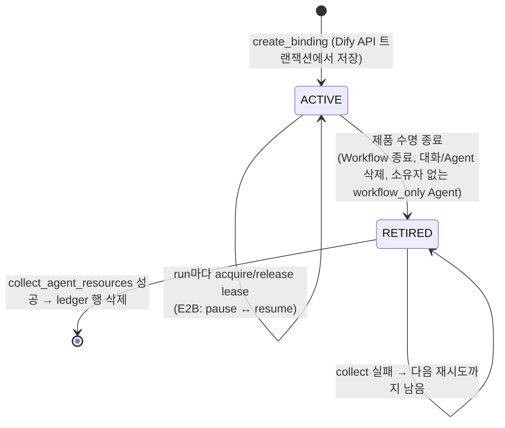

- Retire는 **DB 상태 전환만** 합니다. 호출자 트랜잭션 안에서는 네트워크 I/O를 하지 않습니다. commit한 뒤 Celery가 물리 리소스를 삭제합니다.
- 마지막 Binding을 retire하면 Workspace도 retire합니다. Home Snapshot은 그 Agent가 retire될 때 함께 retire됩니다.
- **TTL, 주기적 GC, orphan reconciler는 없습니다**. backend create는 성공했는데 그 뒤 API commit이 실패하면 물리 리소스가 orphan으로 남을 수 있습니다(문서에 명시된 제약). E2B는 pause만 하고 지우지 않습니다.

## Legacy 경로 요약

### ① Agent Chat 앱 (API 프로세스 내부 루프)

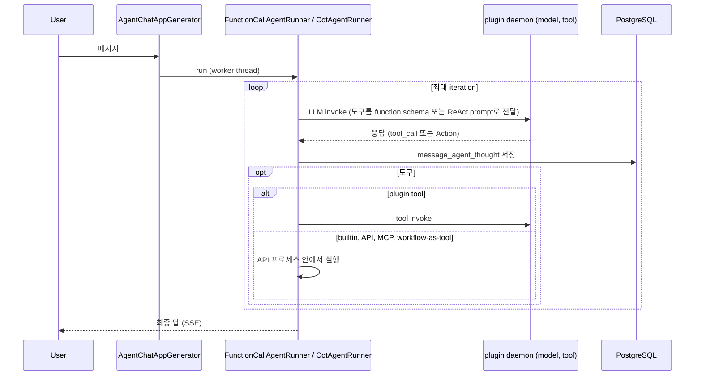

### ② Workflow `agent` 노드 + Agent Strategy 플러그인

- `PluginAgentStrategy` → plugin daemon `POST plugin/{tenant}/dispatch/agent_strategy/invoke`. 루프 자체는 **플러그인 프로세스**가 돌리고, 모델과 도구가 필요하면 daemon의 **backwards invocation**으로 Dify API를 다시 호출합니다.
- plugin daemon 런타임 종류(`dify-plugin-daemon/internal/core`):
  - `local_runtime`: Python venv를 준비한 subprocess. STDIN/STDOUT으로 통신하고 여러 인스턴스에 load balancing한다
  - `debugging_runtime`: 플러그인 개발자가 TCP로 붙는다
  - `serverless_runtime`: AWS Lambda 등에 배포하고 HTTP로 호출한다
- 흐름: Request → Session Manager → io_tunnel(`agent_service.go`) → Plugin Manager → Runtime → Plugin Process. 응답은 같은 경로로 stream됩니다.

### 참고: `dify-sandbox` (Code 노드)

Agent runtime과는 별개입니다. Workflow Code 노드의 Python과 Node.js를 seccomp 기반으로 격리해 실행하는 서비스이고(`sandbox:8194`, `api/core/helper/code_executor`), 네트워크는 `ssrf_proxy`를 거칩니다.

## 보안 모델 요약

| 항목 | 방식 |
|---|---|
| 모델 credential | Dify API만 가지고 있다. Dify Agent는 inner gateway를 호출하고, 샌드박스에는 전달하지 않는다 |
| 서비스 간 인증 | API → Dify Agent는 `DIFY_AGENT_API_TOKEN` Bearer. Dify Agent → API inner는 `X-Inner-Api-Key`. Dify Agent → shellctl은 `SHELLCTL_AUTH_TOKEN`. 샌드박스 → Agent Stub은 5분짜리 JWE |
| 샌드박스 노출 범위 | 샌드박스 ingress에는 `/agent-stub/*`와 `/files/*`만 연다. `/runs`, Binding 관리 route는 노출하지 않는다. inner API URL은 샌드박스에 알려주지 않는다 |
| 파일시스템 격리 | Landlock (Local, OpenShell). E2B, OpenShell, Enterprise는 Binding마다 sandbox를 따로 둔다. Binding 파일 API는 `..`를 막지 않으므로 경계는 backend 격리에 맡긴다 |
| 네트워크 | Compose에서는 squid `agent_ssrf_proxy`를 거친다. OpenShell은 선택적으로 `egress_allow`를 쓴다 |
| 출력 | `DIFY_AGENT_SHELL_REDACT_PATTERNS`로 shell 출력에서 비밀값을 가린다 |
| 한계 | Local backend는 shellctl daemon 하나를 모든 Binding이 같이 쓴다. 공유 backend는 저장소를 격리하지 않으며(문서에 명시), tenant 단위 라우팅도 아직 없다 |

## 주요 설정

| 변수 | 기본값 | 용도 |
|---|---|---|
| `DIFY_AGENT_RUNTIME_BACKEND` | `local` | `local`, `e2b`, `openshell`, `enterprise` |
| `DIFY_AGENT_LOCAL_SANDBOX_ENDPOINT` / `_AUTH_TOKEN` | — | shellctl 주소와 토큰. 주소가 없으면 `runtime` 모듈이 비활성화된다 |
| `DIFY_AGENT_RUN_TIMEOUT_SECONDS` | 3600 | run 벽시계 deadline (`agent_run_limit_exceeded`) |
| `DIFY_AGENT_E2B_ACTIVE_TIMEOUT_SECONDS` | 3600 | E2B 연속 활성 시간. 지나면 pause하고, 삭제하지 않는다 |
| `DIFY_AGENT_RUN_RETENTION_SECONDS` | 7200 | Redis run record와 이벤트 보관 시간 |
| `DIFY_AGENT_PLUGIN_DAEMON_URL`, `DIFY_AGENT_INNER_API_URL` | — | 모델, 도구, inner API 경로 |
| `DIFY_AGENT_STUB_API_BASE_URL`, `DIFY_AGENT_SANDBOX_FILES_BASE_URL`, `DIFY_AGENT_SERVER_SECRET_KEY` | — | 샌드박스 → Stub, 파일 경로, JWE 키 |
| `DIFY_AGENT_APPLICATION_TRACING_ENABLED`, `DIFY_AGENT_TRAJECTORY_*` | false | 애플리케이션 tracing (API inbox로 전송), 배포 단위 OTLP trajectory |
| `SHELLCTL_ENABLE_PATH_ISOLATION`, `SHELLCTL_LANDLOCK_*_PATHS` | true | Landlock 설정 |

## Archestra, 우리 설계와 비교

| 주제 | Dify Agent (v2) | Archestra | 우리 ([runtime-plan.md](runtime-plan.md)) |
|---|---|---|---|
| 루프 위치 | 별도 서비스 프로세스 (Pydantic AI) | 컨테이너 안의 외부 코딩 CLI | 플랫폼 내부 (Anthropic SDK) |
| 샌드박스 역할 | shell 명령과 파일만 실행 (shellctl) | 에이전트 전체 실행 | bash와 파일 편집만 실행 (Docker) |
| 상태 보관 | API DB에 SessionSnapshot(State JSON). 실행기는 stateless | A2A task와 workspace PVC, transcript | 대화 기록을 DB에 저장 |
| 실행 단위 | Run 하나 = API 호출 하나, Binding은 오래 유지 | Task 하나 = turn 하나, Workspace는 오래 유지 | Run 하나 = user 메시지 하나 |
| 비동기 처리 | 프로세스 로컬 asyncio, Redis는 관찰용. 재시도와 handoff 없음 | DB 기반 lifecycle과 reconciler 재채택 | 백그라운드 실행 |
| 격리 backend | Local, E2B, OpenShell, Enterprise를 profile로 교체 | K8s Sandbox CR (driver 인터페이스) | Docker |
| 키 관리 | API inner gateway가 키 보유 | run별 virtual key + binding | 서버 env 키 하나 |
| 리소스 정리 | Retire(DB) 후 Celery collect. TTL 없음 | idle이면 suspend, deadline이면 삭제, reconciler | — |

참고할 만한 패턴은 다섯 가지입니다.
- **Config와 State 분리**: 매 turn 현재 Config를 다시 보내고 State만 snapshot으로 이어 받는다. 설정 변경이 바로 반영되고 resume이 단순해진다.
- **opaque backend ref**: 제품 DB는 backend 종류를 몰라도 된다.
- **Lease scope**: 실행하는 동안에만 샌드박스에 접근하고, `finally`에서 반드시 release한다.
- **Retire와 Collect 분리**: 트랜잭션 안에서는 네트워크 I/O를 하지 않는다.
- **단일 terminal 이벤트의 원자적 보장**: Redis Lua와 cancel intent를 함께 쓴다.

## 출처

- 소스: [langgenius/dify](https://github.com/langgenius/dify), 특히 `dify-agent/docs/dify-agent/**`(run lifecycle, runtime resources, operations guide, layer manuals), `dify-agent/src/dify_agent/**`, `dify-agent-runtime/README.md`, `api/core/app/apps/agent_app/app_runner.py`, `api/core/workflow/nodes/agent_v2/agent_node.py`, `api/models/agent.py`, `api/controllers/inner_api/agent/*`, `docker/docker-compose.yaml`
- [langgenius/dify-plugin-daemon](https://github.com/langgenius/dify-plugin-daemon), `CLAUDE.md`, `internal/core/*`
- [langgenius/dify-sandbox](https://github.com/langgenius/dify-sandbox)
