# 컴포넌트별 시퀀스 다이어그램

주요 기능이 프론트엔드에서 DB까지 어떤 순서로 흐르는지 정리한 문서입니다. 데이터 구조는 [data-model.md](data-model.md)를 참고하세요.

## 참여 컴포넌트

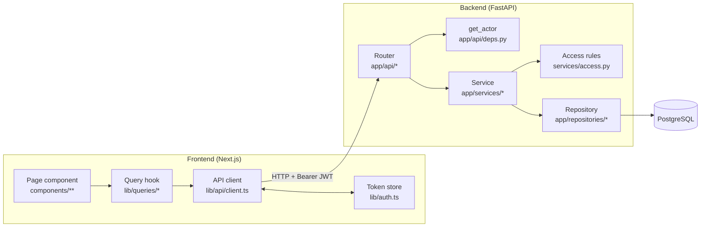

| 계층 | 책임 |
|---|---|
| Page component | 화면, 사용자 입력, URL 상태 |
| Query hook | 캐시 키, 요청, 성공 시 캐시 무효화 |
| API client | 타입이 붙은 HTTP 호출, 토큰 첨부, 401 처리, 에러를 `ApiError`로 변환 |
| Router | 요청 파싱·검증, 서비스 호출 |
| get_actor | JWT 검증 → `Actor` (사용자 + 팀 역할) 생성 |
| Service | 비즈니스 규칙, 트랜잭션 commit, 응답 조립(`hydrate`) |
| Access rules | 볼 수 있는/수정 가능한 agent 판정 (SQL 조건 + Python 함수) |
| Repository | DB 접근만 담당 (규칙 없음) |

## 목차

1. [인증된 요청의 공통 처리](#1-인증된-요청의-공통-처리)
2. [로그인](#2-로그인)
3. [인증 가드와 세션 만료](#3-인증-가드와-세션-만료)
4. [Agent 목록 조회](#4-agent-목록-조회)
5. [Agent 생성](#5-agent-생성)
6. [Agent 수정](#6-agent-수정)
7. [Agent 삭제 · 복원 · 영구 삭제](#7-agent-삭제--복원--영구-삭제)
8. [라벨 동기화](#8-라벨-동기화)
9. [기본 Agent 지정](#9-기본-agent-지정)
10. [팀 멤버 관리 (admin)](#10-팀-멤버-관리-admin)

---

## 1. 인증된 요청의 공통 처리

`/api/auth/login`을 제외한 모든 API는 라우터 실행 전에 `get_actor` 의존성을 거칩니다. 이후 다이어그램에서는 이 과정을 "get_actor"로 줄여 표시합니다.

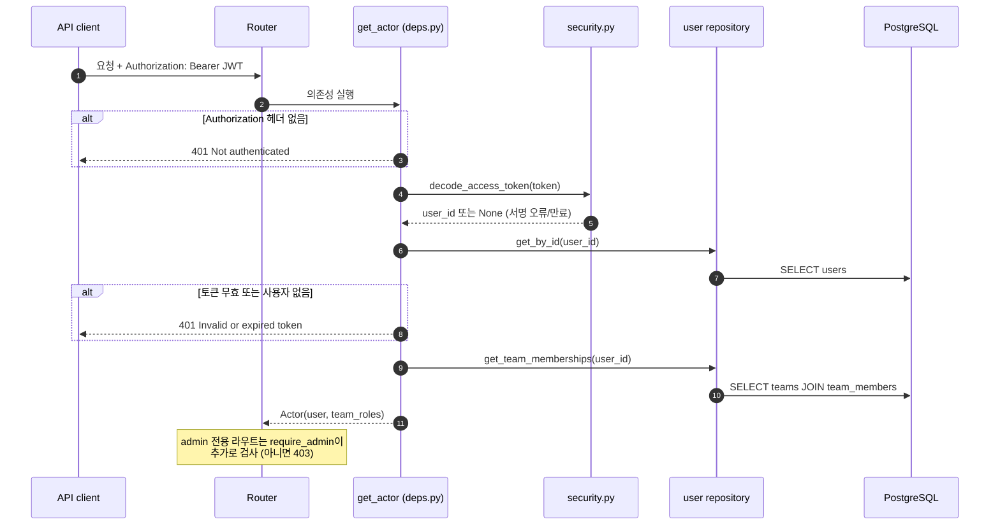

---

## 2. 로그인

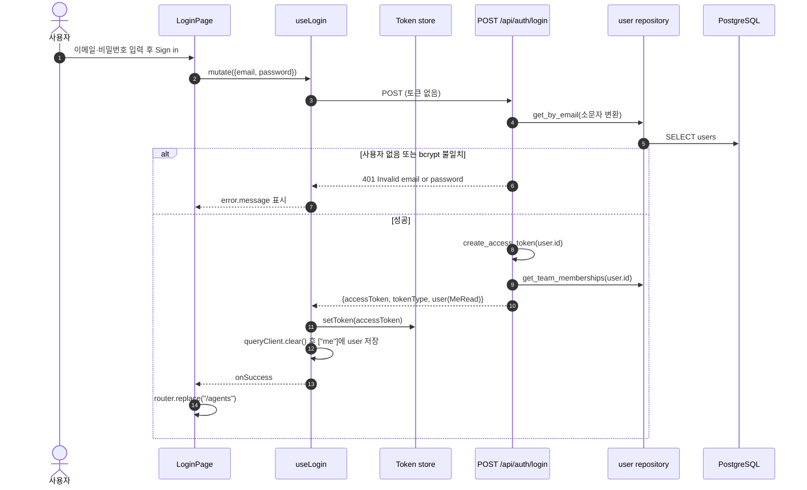

---

## 3. 인증 가드와 세션 만료

보호된 페이지는 모두 `AppShell`로 감싸져 있습니다. 토큰 저장소를 구독하므로, 다른 요청이 401을 받아 토큰이 지워지면 즉시 로그인 화면으로 이동합니다.

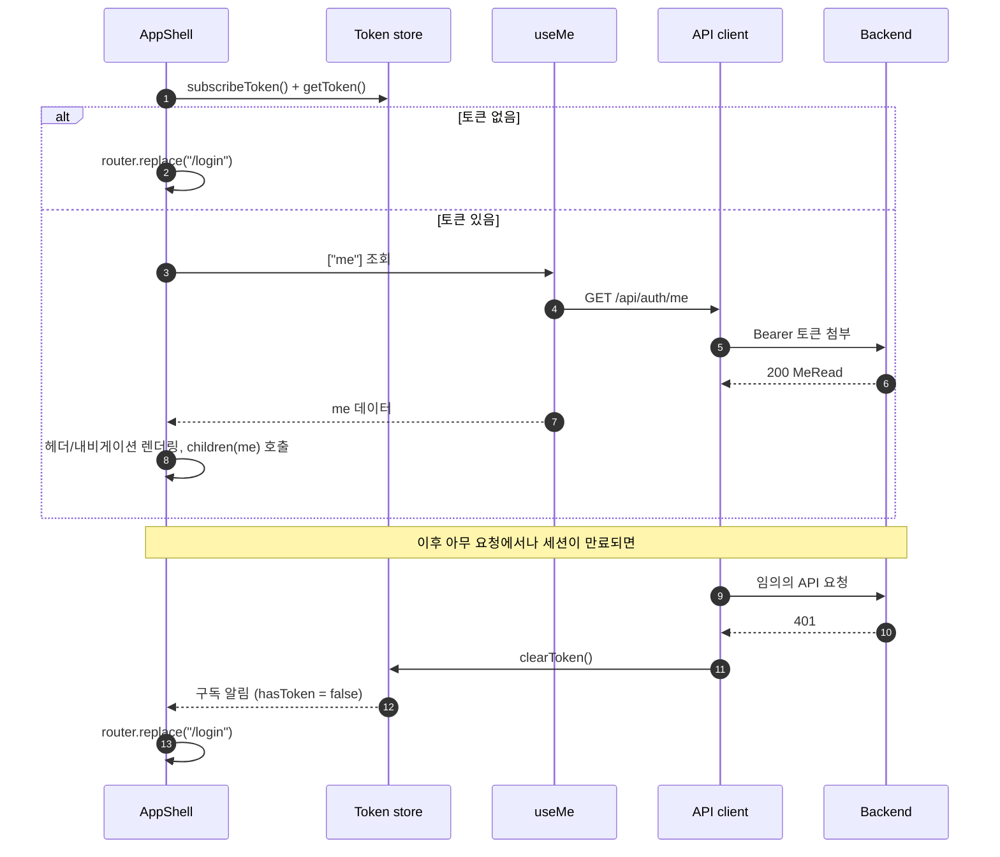

---

## 4. Agent 목록 조회

`GET /api/agents`. 필터 조건은 URL에 있고, 라벨 필터는 `env:prod|dev` 형식에 키 사이를 세미콜론으로 이어 붙입니다 (예: `env:prod|dev` 와 `owner:a` 를 함께 걸면 키끼리 AND, 값끼리 OR).

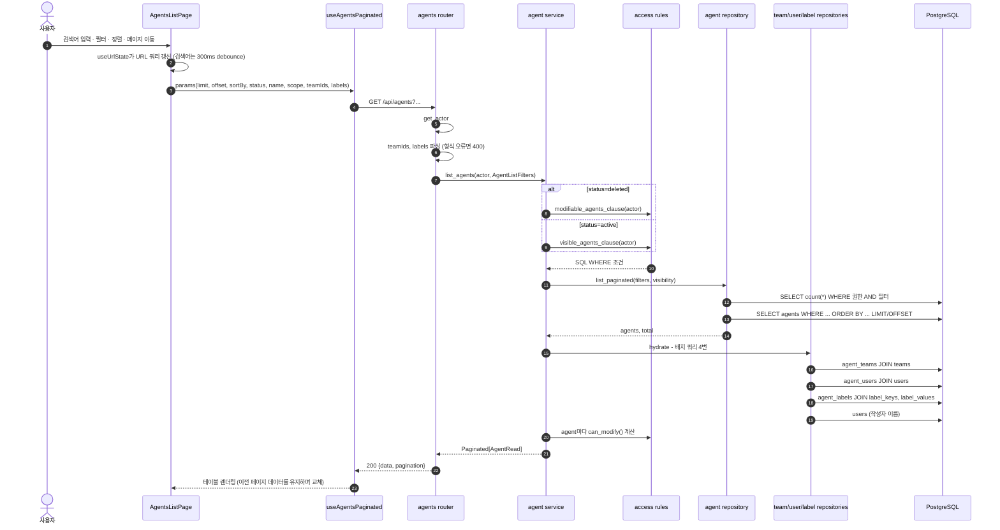

---

## 5. Agent 생성

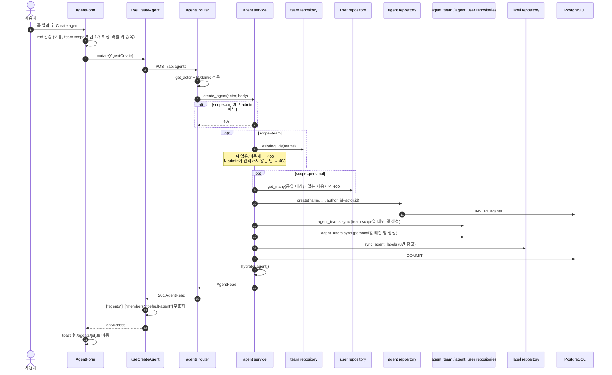

---

## 6. Agent 수정

`PUT /api/agents/{id}`는 부분 수정입니다. 보낸 필드만 바뀌고, 보내지 않은 필드는 그대로입니다.

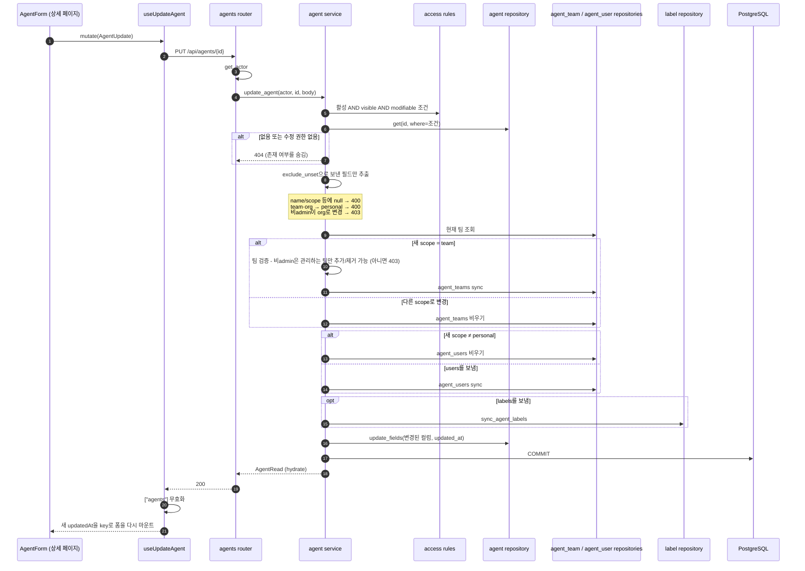

---

## 7. Agent 삭제 · 복원 · 영구 삭제

세 동작 모두 "수정 가능한 agent"에만 허용됩니다. 확인 대화상자는 `DeleteAgentDialog`를 함께 씁니다.

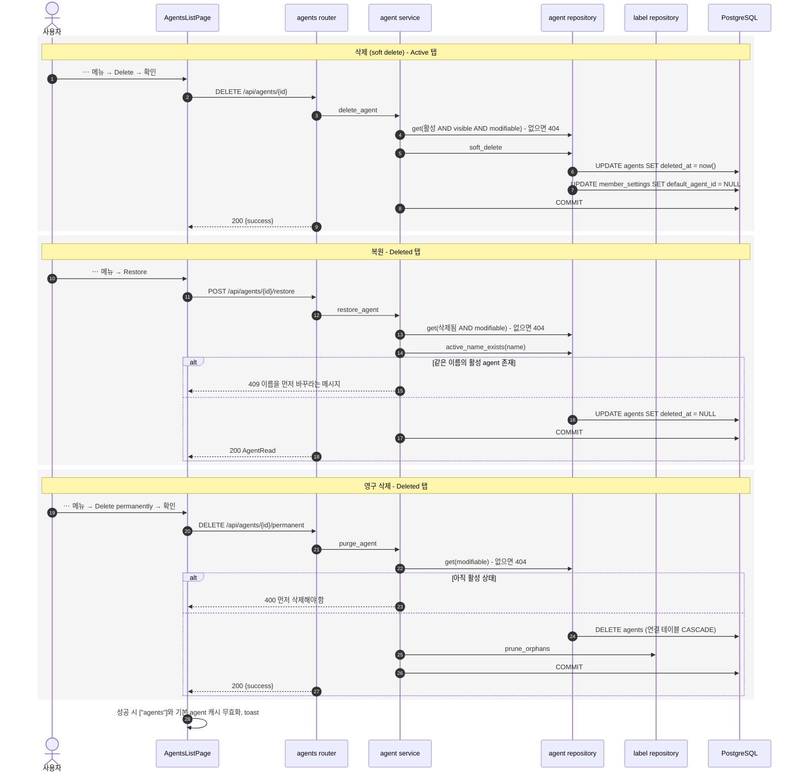

---

## 8. 라벨 동기화

`label_repository.sync_agent_labels`. agent 생성과 수정(labels를 보냈을 때)에서 같은 트랜잭션 안에서 호출됩니다.

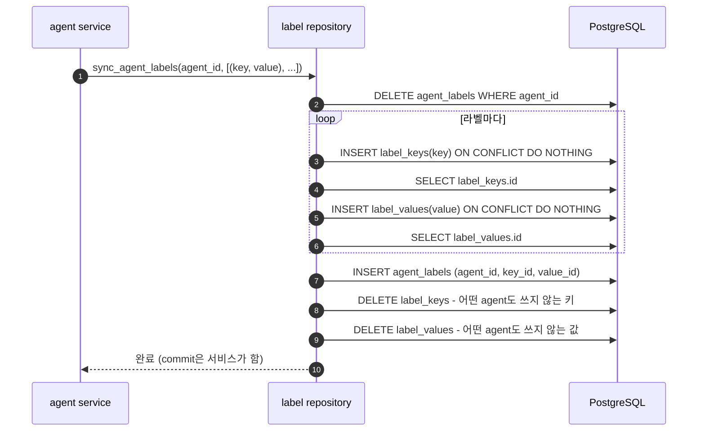

`ON CONFLICT DO NOTHING`을 쓰기 때문에 같은 키를 동시에 만들어도 unique 제약 위반이 나지 않습니다.

---

## 9. 기본 Agent 지정

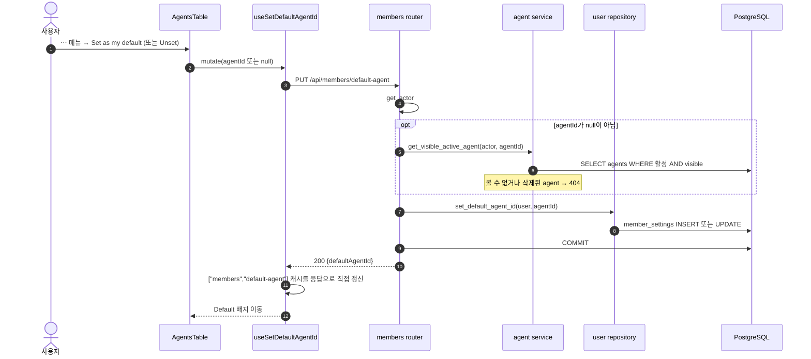

---

## 10. 팀 멤버 관리 (admin)

팀 멤버십은 접근제어의 입력이므로, 변경 후 사용자 정보와 agent 목록 캐시도 함께 무효화합니다.

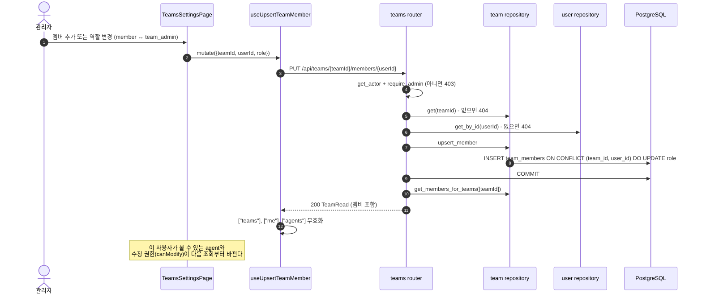
